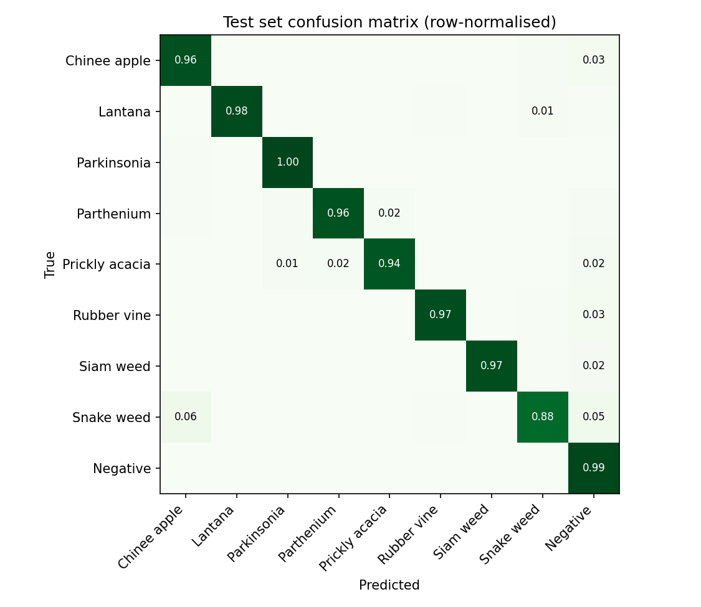
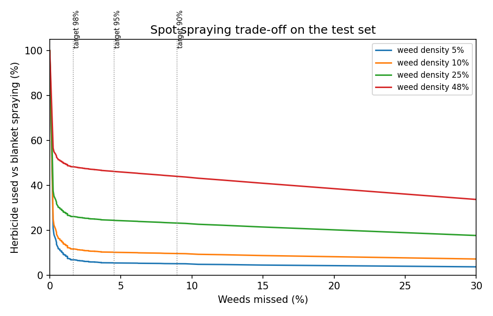

# Precision weed spraying with computer vision

Most herbicide is sprayed over the whole field, even though weeds cover only a small part of it. A camera that can tell a weed from bare ground or pasture lets each nozzle open only where it is needed.

This project trains a small image classifier on real field photos of weeds and then adds the part most tutorials skip: the **spray decision**. It turns model output into open/close commands for a nozzle and measures what a farmer would care about:

- how many weeds the sprayer misses
- how much herbicide it uses compared with blanket spraying
- how fast the vehicle can drive before the computer falls behind

It follows on from my BSc thesis, a vision-guided spray painting robot with under 5 mm positioning accuracy. Same chain (camera, decision, nozzle), different job.

## Data

[DeepWeeds](https://github.com/AlexOlsen/DeepWeeds) (Olsen et al., *Scientific Reports*, 2019): 17,509 photos taken in the field across northern Australia, covering eight weed species plus a "Negative" class with no target weed (9,106 images). Licence CC BY 4.0. I use the authors' official train/validation/test split (fold 0) so the numbers can be compared with the paper.

## Method

1. **Classifier.** MobileNetV3-Large pretrained on ImageNet, fine-tuned for 12 epochs with augmentation suited to field images (any rotation, flips, strong lighting changes). MobileNetV3 was chosen because it is small enough for an onboard computer. ResNet-50, the paper's baseline, is also available.
2. **Spray rule.** For each image, weed probability = 1 − P(Negative). The nozzle opens when that is at or above a threshold.
3. **Choosing the threshold.** On the validation set, I pick the threshold that uses the least herbicide while still spraying a target share of weeds (90, 95 or 98 %). That threshold is then applied unchanged to the test set, so the test result is not tuned on the test data.
4. **Herbicide use at realistic weed density.** DeepWeeds is about half weeds, much weedier than a typical field. With weed density *d*, true positive rate TPR and false positive rate FPR:

   herbicide used = *d* × TPR + (1 − *d*) × FPR

   I report it at the dataset density and at 5, 10 and 25 %.
5. **Speed limit.** I measure single-image inference time on 2 CPU threads (roughly a small embedded board) and on a GPU. If one image covers *L* metres of ground along the direction of travel, the vehicle cannot go faster than *L* / latency. *L* = 0.45 m is an assumption; change `--footprint` to match a real camera.

The spray logic has unit tests (`tests/test_spray.py`), for example: a perfect classifier uses herbicide only on weeds, a threshold of zero equals blanket spraying, and the chosen threshold always meets its recall target on the data it was chosen on.

## Results

MobileNetV3-Large, official fold 0, trained for 12 epochs on a Colab T4 GPU (about 100 s per epoch).

**Classification (test set, 3,507 images):** accuracy 97.2 %, macro-F1 0.962. For reference, the DeepWeeds paper reports 95.7 % for ResNet-50, averaged over all five folds; this is a single fold, so the two numbers are not a strict comparison. Snake weed is the hardest class (88 % recall), mostly confused with Chinee apple.



**Spray decisions.** The threshold is chosen on the validation set, then applied to the test set:

| Recall target (val) | Weeds missed (test) | Clean patches sprayed | Herbicide vs blanket at 10 % weed cover | at 25 % |
|---|---|---|---|---|
| 90 % | 9.0 % | 0.6 % | 9.6 % | 23.2 % |
| 95 % | 4.5 % | 0.7 % | 10.1 % | 24.4 % |
| 98 % | 1.7 % | 2.0 % | 11.6 % | 26.1 % |

At the 95 % setting, a field with 10 % weed cover gets about one tenth of the herbicide of blanket spraying, and 4.5 % of weeds are missed. The ideal would be exactly 10 % (spray every weed and nothing else), so the model wastes very little. The real limit is missed weeds: Snake weed (8.8 % missed) and Prickly acacia (6.6 %) slip through most often. Asking for 98 % recall cuts misses to 1.7 % for a small increase in spraying.



**Speed.** 32.5 ms per image on 2 CPU threads and 8.2 ms on a T4 GPU. With the assumed 0.45 m image footprint, that allows about 50 km/h on the CPU and 197 km/h on the GPU. Inference time is unlikely to be the bottleneck; camera exposure, valve delay and locating the weed inside the image would be.

Validation accuracy was still improving at epoch 12, so a longer run would probably gain a little more.

## Run it

The easiest way is Google Colab with a free GPU: open `run_on_colab.ipynb`, choose a T4 GPU runtime and run all the cells (about 30 minutes).

Locally:

```bash
pip install -r requirements.txt
python src/data.py --root data            # downloads 468 MB
python src/train.py --root data --epochs 12
python src/evaluate.py --root data
python src/latency.py
python src/spray.py
python src/make_figures.py
pytest -q
```

## Limitations

- Each photo is treated as the ground under one nozzle. A real sprayer sees a continuous strip, needs weeds located inside the image, and has valve delay and boom movement to deal with.
- DeepWeeds shows weeds in rangeland, not weeds among crop rows. Telling a weed from a crop plant is harder. PhenoBench (sugar beet, University of Bonn) would be the next dataset to try.
- The speed limit ignores camera exposure, image transfer and valve response time, so it is an upper bound.
- The CPU timing is on a cloud machine limited to 2 threads, not on real embedded hardware.

## Structure

```
src/data.py          download and official splits
src/models.py        MobileNetV3 / EfficientNet-B0 / ResNet-50, transforms
src/train.py         fine-tuning
src/evaluate.py      class probabilities for validation and test
src/spray.py         spray decision layer and metrics
src/latency.py       inference timing
src/make_figures.py  figures
tests/test_spray.py  tests for the spray logic
run_on_colab.ipynb   everything in one notebook
```

Dataset: A. Olsen et al., "DeepWeeds: A Multiclass Weed Species Image Dataset for Deep Learning," *Scientific Reports* 9, 2058 (2019).
